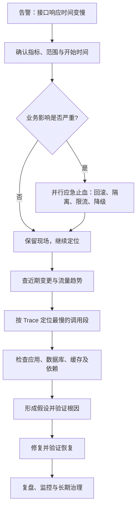

# 线上问题排查：接口响应时间突然变慢，怎么排查和解决

> **视频来源**：[接口响应时间突然变慢，怎么排查和解决](https://www.bilibili.com/video/BV1zync69E5N/)  
> **UP 主**：tojson ｜ **发布时间**：2026-10-20 ｜ **时长**：约 26 分 46 秒  
> **整理说明**：本笔记以视频页面公开简介为直接依据，提炼其明确提出的「查变更 → 看流量 → 定位调用链 → 根因分析 → 应急止血 → 长期治理」主线，再结合通用后端生产排障实践展开。**视频页面未提供可读取的完整字幕，因此以下详细操作、命令和模拟案例属于扩展学习内容，不等同于视频逐字转录；不对视频中具体生产案例的细节作无依据推断。**

## 一、先抓住核心：线上接口突然变慢，不能上来就改代码

假设订单查询接口过去 P95 延迟约 200 ms，现在突然变成 2 s。此时既可能是某次发布引入慢 SQL，也可能是流量激增、下游超时、线程池排队，甚至是节点级 GC 抖动。

**最重要的思路是：先确认异常，缩小范围，再沿实际调用链用证据定位瓶颈；同时根据影响程度决定是否先止血。**



### 快速判断题：慢在哪里？

| 现象 | 优先怀疑 | 下一步证据 |
| --- | --- | --- |
| 发布后某接口突然变慢，其他接口正常 | 新代码、SQL、配置、依赖版本 | 发布记录、灰度分组、慢请求 Trace |
| 全部接口都变慢，CPU 很高 | 计算热点、GC、线程调度、流量过载 | CPU/GC/线程栈、QPS 与实例分布 |
| CPU 不高，但延迟和超时都很高 | 锁等待、线程池/连接池排队、下游阻塞 | 线程状态、池等待时间、下游 Span |
| QPS 激增且 P99 恶化 | 容量不足、排队、热点流量 | QPS、并发、队列长度、限流量 |
| 只有涉及数据库的接口变慢 | 慢 SQL、索引/执行计划、锁、连接池 | 慢查询、EXPLAIN、锁等待、连接数 |
| 偶发尖刺，伴随 Stop-The-World | JVM GC 暂停 | GC 日志、暂停耗时、内存分配速率 |
| 只有部分实例或某个机房慢 | 单实例异常、资源限额、网络、区域故障 | 实例维度的延迟/错误/资源图 |

注意：**相关不等于因果**。例如 CPU 升高与延迟升高同时发生，仍须区分「CPU 导致慢」和「慢请求引发堆积导致 CPU 升高」。

## 二、第一步：确认“真的变慢”，量化故障影响

在动手操作前，用监控面板或日志回答：

1. **什么时候开始慢？** 精确到分钟，与发布、配置、任务、流量事件对齐。
2. **哪些接口、用户或区域受影响？** 单接口还是全站；所有租户还是特定租户；单实例还是全实例。
3. **慢了多少？** 对比故障前后 **P50 / P95 / P99 延迟、请求量 RPS/QPS、5xx/超时率**，避免只看平均响应时间。
4. **是否存在关联现象？** CPU、内存、GC、线程数、连接池等待、数据库慢查询、Redis 命中率、外部服务错误率。
5. **业务后果是什么？** 下单成功率、支付成功率、核心交易受损、超时重试引起的额外流量等。

建议记录一个故障快照（下列数据仅为填写示例，非视频实际数据）：

| 字段 | 示例 |
| --- | --- |
| 故障开始 | 14:32 |
| 受影响接口 | `GET /api/orders/{id}` |
| 正常 / 异常 P95 | 200 ms / 2,000 ms |
| QPS | 600 → 850 |
| 错误率 | 0.1% → 3.2% |
| 影响范围 | 单个机房、部分订单查询 |
| 最近变更 | 14:25 发布订单服务 v2.3 |

**关键原则：先有基线，再讨论“优化了多少”；没有时间线，就很难排除巧合。**

## 三、第二步：查变更、看流量（最快缩小范围）

### 3.1 查变更

排查故障开始前后发生的变化：

- 应用发布：代码改动、依赖升级、SQL 改写、新功能、灰度策略。
- 运行配置：超时、重试、连接池、线程池、JVM 参数、限流阈值。
- 基础设施：容器重调度、节点扩缩容、网络策略、DNS、负载均衡。
- 数据状态：表数据量增长、索引变更、统计信息变化、定时批任务。
- 外部依赖：第三方 API、Redis/MySQL、RPC 服务发布或异常。

**验证方式**：异常时间是否吻合？只在新版本实例上出现吗？回滚/关闭特性开关是否使指标恢复？回滚前要评估数据库兼容性、数据迁移和未完成请求的风险。

### 3.2 看流量

关注「流量增加」与「系统处理能力下降」两类可能：

- 看入口 **QPS、并发数、请求体大小、响应体大小、热点参数/热点 Key**。
- 看 **重试量**：下游变慢可能导致上游重试，再放大总流量，形成级联故障。
- 看不同实例的流量是否均衡，是否某个节点被异常分流。
- 看高峰是否碰到 **线程池、连接池、数据库连接数、网关连接数** 上限。

一个容易忽略的区别：

> **响应时间 = 排队等待 + 实际处理 + 下游等待 + 网络传输等耗时。** CPU 不满并不表示服务没有容量问题；线程/连接池耗尽时，大量时间可能花在等待上。

## 四、第三步：沿调用链找“时间到底花在哪”

建议通过分布式链路追踪（如 SkyWalking、Jaeger、Zipkin、OpenTelemetry 体系）按请求的 **Trace ID** 定位一条慢请求：

```text
用户
  ↓
网关（Gateway）
  ↓
订单服务（Order Service）
  ├─ 本地处理：参数校验、业务逻辑
  ├─ Redis：查询缓存
  ├─ MySQL：查询订单 / 等待连接
  └─ RPC/HTTP：请求库存或用户服务
  ↓
返回响应
```

### 操作顺序

1. 在告警时间窗口筛选慢请求，尽可能按接口、实例、版本、区域和用户群分组。
2. 打开典型慢请求的 Trace，找出关键路径上耗时明显增加的 Span。
3. 再比较**正常请求**与**慢请求**的差异：哪个 Span 从几十毫秒变成几百毫秒？
4. 核对每段的错误、超时、重试、连接等待与排队时间；必要时结合应用日志里的 Trace ID。
5. 将瓶颈定位到具体组件后，再进入专项排查，而不是平均地检查所有组件。

**注意**：并行调用的各个 Span 不能简单相加当作总请求耗时；父子 Span 也可能重叠。要看关键路径、包含关系与等待时间，避免重复计时。

### 假设性调用链例子（非视频案例）

```text
Gateway              15 ms
OrderService       1,920 ms
  ├─ Redis           8 ms
  ├─ 获取 DB 连接  1,600 ms  ← 主要等待点
  ├─ SQL 执行       250 ms
  └─ 业务处理       40 ms
```

这种情况应**优先调查数据库连接池为何耗尽或连接为何迟迟不能释放**，而不是看到“涉及 MySQL”就直接加索引。

## 五、第四步：按瓶颈类型做专项排查

### 5.1 应用/JVM

| 信号 | 排查方向 | 可行动作 |
| --- | --- | --- |
| CPU 长期高 | 热循环、序列化、正则、加解密、频繁对象创建 | 采样 CPU Profile/火焰图、核对热点方法 |
| GC 停顿时间增加 | 堆压力、对象分配过快、内存泄漏 | GC 日志、堆使用趋势、分配速率 |
| 大量线程 WAITING/BLOCKED | 锁竞争、线程池阻塞、依赖同步等待 | 线程栈、锁持有者、队列长度 |
| 连接池等待时间很长 | 连接泄漏、SQL 慢、连接池配额不足 | 活跃/空闲/等待连接数、超时日志 |
| 只有某些 Pod 慢 | CPU throttling、节点抖动、局部流量 | Pod/节点维度指标、配额与重启事件 |

在**有权限且不会对生产造成不可接受影响**时，可以使用以下只读/诊断命令（按实际运行环境调整）：

```bash
# Linux：主机资源，先观察趋势，不凭一次采样下结论
top
free -h
df -h
vmstat 1 5

# Java：先确认 PID；采样和生成诊断文件会有开销
jcmd <PID> Thread.print > thread-dump.txt
jcmd <PID> GC.heap_info
jstat -gcutil <PID> 1000 5

# Kubernetes：查看 Pod 资源、事件、重启情况
kubectl top pods -n <namespace>
kubectl describe pod <pod-name> -n <namespace>
kubectl logs <pod-name> -n <namespace> --since=15m
```

提示：Kubernetes CPU 限额引起的 **throttling** 要结合容器指标确认；节点 CPU 不满也不代表容器没有被限制。抓取堆转储、开启重型 profiler 前应做风险评估。

### 5.2 MySQL

依次看：

1. 慢查询日志：是否出现新的慢 SQL；是扫描量变大，还是等待变长？
2. 查询计划：`EXPLAIN` 是否走预期索引；过滤性、回表、排序、临时表是否合理？
3. 锁与事务：是否有长事务、锁等待、热点行争用？
4. 连接池/数据库连接：应用侧等待是池不够，还是 SQL/事务长期占用连接？
5. 数据库主机和存储：CPU、IOPS、磁盘延迟、Buffer Pool 命中情况、主从延迟。

```sql
-- 示例：根据权限及数据库版本选择适用的只读诊断命令
SHOW FULL PROCESSLIST;

-- 排查具体慢 SQL 时替换为真实查询；
-- 生产环境谨慎执行，避免直接运行可能昂贵的分析类语句。
EXPLAIN SELECT * FROM orders WHERE user_id = 123;
```

**重要区分**：「执行 SQL 慢」与「等待获取数据库连接慢」的解决方式完全不同；不能仅凭总耗时把责任归到 SQL。

### 5.3 Redis / 缓存

检查：

- 缓存命中率是否骤降；是否发生大批 Key 同时过期或热点 Key 失效？
- 是否出现热点 Key/大 Key，导致单实例阻塞或网络开销异常？
- Redis 慢命令、网络 RTT、连接池耗时、超时与重试。
- 缓存穿透、击穿、雪崩是否使大量请求绕过缓存打到数据库？

```bash
# Redis CLI 示例；需具备只读诊断权限
redis-cli INFO stats
redis-cli SLOWLOG GET 10
```

`keyspace_hits`、`keyspace_misses` 是累计值，比较命中率变化时应按两个时间点的**增量**计算，避免把历史平均值当作当前状态。

### 5.4 下游服务 / 网络

- 外部 HTTP/RPC 是否超时？目标服务自己的 P95/P99 是否上升？
- **请求超时、连接超时、排队等待**能否区分？
- 是否新增同步串行调用、重试次数过多、重试没有退避/抖动？
- 是否有 DNS、TLS 建连、TCP 重传、负载均衡异常？

在可达的合法测试目标上，可先分解客户端请求各阶段耗时：

```bash
curl -sS -o /dev/null \
  -w 'DNS=%{time_namelookup}s TCP=%{time_connect}s TLS=%{time_appconnect}s TTFB=%{time_starttransfer}s TOTAL=%{time_total}s\n' \
  'https://example.com/api/health'
```

这些 curl 时间大多是**从请求开始计算的累计时间点**，并非可直接相加的独立阶段时长；且客户端视角不等于服务端处理时长。

## 六、第五步：止血优先，但不能制造第二次故障

当错误率/延迟已经影响核心业务时，**排障与恢复并行**，优先采用可控、可回退、能快速观察效果的措施。

| 场景 | 可考虑的止血方案 | 关键风险 |
| --- | --- | --- |
| 新版本发布后恶化 | 暂停发布、关闭功能开关、回滚 | 数据库 Schema/数据写入兼容性 |
| 突发过载 | 网关限流、优先保障核心业务、弹性扩容 | 误伤正常请求、扩容无法解决下游瓶颈 |
| 下游服务抖动 | 快速失败、熔断、限重试、降级 | 降级是否符合业务一致性要求 |
| 热点/缓存故障 | 热点隔离、受控预热、请求合并 | 缓存重建引起新的流量冲击 |
| 慢 SQL/锁等待 | 停止异常批任务、恢复原方案、评估隔离 | 随意 kill 事务可能导致长时间回滚 |
| 连接池耗尽 | 定位长占用、降低压力、按容量调整配额 | 盲目增大连接池可能压垮数据库 |

**不要在没有依据时同时改多个参数**，否则效果不可归因且难以回滚。生产变更应走既定应急流程，记录操作人、时间、变更和观测结果。

## 七、第六步：用“假设—证据—验证”确定根因

建立一张小表，避免凭经验拍脑袋：

| 假设 | 支持证据 | 反证/验证动作 | 结论 |
| --- | --- | --- | --- |
| 最近发布导致慢 SQL | 故障时间与发布时间吻合，SQL Span 增加 | 比较新旧版本 Trace、执行计划；受控回滚 | 待验证 |
| 流量增长导致连接池排队 | QPS、并发、等待连接数同步增长 | 对比池活跃数、DB 利用率；受控限流 | 待验证 |
| 下游 RPC 变慢 | 慢请求均有下游等待时间扩大 | 调取下游 SLI、网络指标和依赖 Trace | 待验证 |

**根因不等于最显眼的症状**。例如接口慢、线程池排队和数据库连接池耗尽可能是一串因果链；最终触发点可能是某条长事务占住连接。

### 从假设到恢复的完整演练（纯示例，非视频实际事故）

1. 14:32 接口 P95 从 200 ms 增至 2 s，错误率上升。
2. 排除全站问题，锁定订单查询接口，发现 14:25 有发布。
3. 对比 Trace：新版本的 DB Span 明显增长，并伴随连接池等待。
4. 看 SQL、慢查询和执行计划：发现新增查询没有使用期望的索引，导致连接被占用更久。
5. 评估兼容性后回滚新版本，观察延迟与连接池等待恢复。
6. 在测试环境修复查询/索引方案，回归测试，再灰度发布。
7. 为关键 SQL、连接池等待和接口 P99 增加告警。

这里的因果链应由数据证实，不能只因“回滚后好了”就忽略其他同时发生的变化。

## 八、如何确认已经恢复？

不仅要看到 P95 下降，还要检查：

- 同时观察 **P50/P95/P99、错误率、吞吐、超时、重试、核心业务成功率**。
- 实例资源、线程池、连接池、慢 SQL/GC 是否回到可接受范围。
- 流量已经恢复正常，而不是“因大量请求失败或被限流，所以看起来很快”。
- 在设定的观察窗口内保持稳定；检查其他区域、实例与下游是否出现转移性故障。
- 保留回滚方案，并记录本次时间线、变更与关键证据。

## 九、长期治理：让下一次问题更容易被发现和解决

1. **可观测性**：统一 Metrics、Logs、Traces；关键日志关联 Trace ID、版本、实例和业务维度。
2. **指标与 SLO**：接口延迟分位数、可用性、错误率、饱和度；设置分层告警，减少只看 CPU 的盲区。
3. **容量与弹性**：压测出拐点，监控线程池、连接池、DB 容量和服务间重试放大。
4. **发布安全**：灰度、金丝雀、可回滚、特性开关、发布前后自动对比指标。
5. **依赖保护**：合理超时预算，熔断、限流、隔离、带退避和抖动的有界重试。
6. **数据库与缓存治理**：慢 SQL 审核、索引维护、热点 Key 监测、缓存重建保护。
7. **事故复盘**：明确触发条件、传播路径、探测延迟、恢复过程，以及负责人和整改完成标准。

## 十、值班时可直接使用的 Runbook

```text
[ ] 记录告警时间、接口、环境、版本、影响范围
[ ] 观察 P50/P95/P99、QPS、错误率、超时率及业务成功率
[ ] 判断是否需要先止血；建立事件沟通渠道
[ ] 对齐发布/配置/定时任务/流量变化的时间线
[ ] 从一个慢请求 Trace 找到关键路径上的慢 Span
[ ] 区分排队时间、CPU 计算、GC、锁、DB、缓存、RPC/网络
[ ] 用日志/指标/对照实验验证根因，记录排除过的假设
[ ] 选择低风险措施，记录执行时间并观察回滚条件
[ ] 验证延迟、错误率、吞吐和核心业务指标持续恢复
[ ] 复盘并补齐监控、压测、限流与发布防护
```

## 十一、面试/复述版（约 1 分钟）

> 线上接口突然变慢，我会先确认告警的真实性和影响范围，对比故障前后的 P95/P99、QPS、错误率，明确是单接口、单实例还是全链路问题。如果影响核心业务，先按应急预案回滚、限流或降级止血。然后对齐发布时间线、配置变化和流量趋势，用 Trace ID 查看慢请求的调用链，区分服务端排队、业务计算、GC、数据库、缓存和下游 RPC 耗时。找到异常 Span 后，再结合线程栈、GC、慢 SQL、连接池等证据验证具体根因。修复后要验证延迟、错误率和业务成功率都恢复，最后通过复盘、可观测性、灰度发布与容量治理预防复发。

---

### 来源与范围

- 视频：[接口响应时间突然变慢，怎么排查和解决（BV1zync69E5N）](https://www.bilibili.com/video/BV1zync69E5N/)
- 视频页面简介确认的主题：**真实生产故障场景、查变更、看流量、定位调用链、根因分析、应急止血、长期治理**。
- 本文件将上述主题扩展为**可复习、可演练的技术排查手册**；没有可核对的字幕时，未标注具体的原视频时间戳或虚构原视频中的故障数据。

---

## 附录 A：SkyWalking 分布式链路追踪详解（Trace、Segment、Span）

> **学习来源**：[CSDN：SkyWalking - 分布式追踪基本概念：Trace、Span、Segment 是什么](https://blog.csdn.net/qq_41187124/article/details/157510362)  
> **性质**：基于文章知识点重新组织的原创学习笔记，配合线上慢接口排查场景；不逐字转载原文。文中的下单、数据库和支付耗时均为**教学用模拟数据**，并非原文事故记录。  
> **阅读顺序**：先理解为什么需要追踪，再理解 Trace / Segment / Span 与上下文传播，最后读瀑布图排查故障。

### A.1 为什么微服务必须有链路追踪？

单体 Java 应用中，给方法打日志、记录耗时，往往就能快速排查；微服务中一次“用户下单”可能穿过网关、订单服务、库存服务、支付服务、MySQL 和第三方接口。各服务的日志和线程彼此独立，仅凭时间戳很难把同一请求的记录对应起来。

\`\`\`mermaid
flowchart LR
  U[用户 POST /orders] --> G[Gateway]
  G --> O[Order Service]
  O --> I[Inventory Service]
  O --> P[Payment Service]
  I --> DB[(MySQL)]
  P --> X[第三方支付 API]
\`\`\`

用户反馈“以前 200ms，现在 2s”，你首先要知道：究竟是哪个**服务**慢、哪个**操作**慢、是在**执行**还是在**排队/等待**。链路追踪的核心价值是还原调用关系和耗时结构，而不是直接自动判断根因。

### A.2 三个概念一张表记清楚

| 对象 | 是什么 | 标识/关系 | 在排障时回答什么 |
| --- | --- | --- | --- |
| **Trace** | 一次分布式请求的整体追踪 | 全局关联的 \`traceId\` | 这个请求经过了哪些服务？ |
| **Segment（Trace Segment）** | 一个进程内、一个追踪上下文所产生的一组 Span；是 SkyWalking 原生上报模型的单位 | \`traceSegmentId\`；可引用上游 Segment 的 Span | 这个服务/追踪上下文记录了哪些操作？ |
| **Span** | 一次具体操作及其时间范围（入口、内部操作、外部调用） | \`spanId\`、\`parentSpanId\`，在 Segment 内建立父子关系 | 时间花在了哪一步？ |

**准确理解 Segment**：不能说“一个 JVM 只有一个 Segment”或者“一个服务就是一个 Segment”。同一个服务会处理许多请求、生成许多 Segment；一次追踪也可能由于异步处理/上下文切换包含多个 Segment。不同 Segment 通过引用关系相连。

一个简化的下单 Trace（图中每组 Segment 为教学假设）：

\`\`\`text
Trace：T-10086（用户本次下单）
│
├─ Segment A：订单服务
│  ├─ Span 0 [Entry] POST /orders
│  ├─ Span 1 [Local] validateOrder
│  ├─ Span 2 [Exit]  HTTP callInventory
│  └─ Span 3 [Exit]  HTTP callPayment
│
├─ Segment B：库存服务
│  ├─ Span 0 [Entry] POST /deduct  -- 引用 A / Span 2
│  └─ Span 1 [Exit]  JDBC UPDATE inventory
│
└─ Segment C：支付服务
   ├─ Span 0 [Entry] POST /pay     -- 引用 A / Span 3
   └─ Span 1 [Exit]  HTTP callBankApi
\`\`\`

**只共享 Trace ID 不够**：它只能说明“这些操作属于同一次追踪”；要知道“库存服务是由订单服务哪个出口调用触发的”，还需要上游的 \`traceSegmentId\`、\`spanId\` 等引用信息。

### A.3 三种 Span：Entry / Local / Exit

| 类型 | 从当前服务的视角看 | 常见例子 |
| --- | --- | --- |
| **Entry Span** | 收到一个外部请求、进入当前服务 | Spring MVC Controller、RPC 服务端 |
| **Local Span** | 当前服务内部执行的操作 | 自定义业务校验、内部风控函数（需要适配的插件或手动埋点） |
| **Exit Span** | 当前服务发出对外请求 | HTTP/RPC 客户端、JDBC 调用、Redis 请求 |

以订单服务调用库存服务为例：

\`\`\`text
Order Service                  Inventory Service
  Exit Span（调用库存） ───────→ Entry Span（接收库存请求）
  耗时 500ms                       处理耗时 460ms
\`\`\`

- 左边 500ms 是**调用方视角**，可包含请求准备、网络、等待响应等；
- 右边 460ms 是**服务端入口视角**，由各自埋点的起止边界决定；
- 二者时间段**大部分重叠**，不能做 \`500 + 460\` 的耗时相加；
- **不是每个普通 Java 方法都会自动得到一个 Local Span**；不要误以为 SkyWalking 默认记录了所有方法的执行时间。

典型 Span 信息包括：操作名、开始/结束时间、类型、\`spanId\`、\`parentSpanId\`、组件、目标地址（peer）、标签、错误信息和跨 Segment 的引用。SkyWalking 原生 Trace 协议中普通 Span 的起止时间使用**毫秒时间戳**，不是文章个别示例中写的“纳秒级”。

### A.4 跨进程传播：订单服务为什么能和库存服务在同一个 Trace？

订单服务 JVM 的 \`ThreadLocal\` 不会自动进入库存服务 JVM。跨进程关联依赖**追踪上下文传播（Context Propagation）**：

1. 订单服务收到请求，Agent 创建或续接 Trace 上下文。
2. 订单服务向库存服务发起调用时，创建 Exit Span。
3. HTTP/RPC 插件在请求头或协议附件中**注入**追踪上下文。
4. 库存服务入口插件**提取**上下文，创建 Entry Span 和对上游 Segment/Span 的引用。
5. 各服务分别上报追踪数据，OAP 能将其组成一条完整链路。

SkyWalking 的原生跨进程 HTTP Header 是 \`sw8\`。v3 标准 Header 有 **8 个以连字符分隔的字段**（字符串字段使用 Base64 编码）：

| 顺序 | 字段 | 作用 |
| --- | --- | --- |
| 1 | Sample | 是否采样（0/1） |
| 2 | Trace ID | 整条追踪的全局关联标识 |
| 3 | Parent Trace Segment ID | 调用方所在 Segment |
| 4 | Parent Span ID | 调用方具体 Exit Span |
| 5 | Parent Service | 调用方服务 |
| 6 | Parent Service Instance | 调用方实例 |
| 7 | Parent Endpoint | 调用方入口操作 |
| 8 | Target Address | 调用方视角的目标地址 |

注意：**\`spanId\` 是 Segment 内编号，不是全局唯一 ID**；跨 Segment 关联要结合父 Segment ID。Dubbo 可以通过 Attachment 传播；Kafka/RabbitMQ 等通过消息属性等载体传播，但实际取决于 Agent 插件、框架版本和具体异步场景，不能默认所有路径都自动打通。

官方协议：  
- [SkyWalking Cross Process Propagation Headers Protocol（sw8）](https://skywalking.apache.org/docs/main/v10.4.0/en/api/x-process-propagation-headers-v3/)  
- [SkyWalking Trace Data Protocol v3](https://skywalking.apache.org/docs/main/v10.3.0/en/api/trace-data-protocol-v3/)

### A.5 从 Agent 到 UI：链路是怎么产生的？

\`\`\`mermaid
flowchart TD
    A[Java 应用 + SkyWalking Agent] -->|Span / Segment 上报| O[OAP Server]
    B[其他微服务 + Agent] -->|Span / Segment 上报| O
    O --> S[(Trace/Metric 存储)]
    S --> O
    O --> U[SkyWalking UI]
    U --> Q[按 Trace ID 查询调用链和耗时]
\`\`\`

- **Agent**：在应用内收集追踪信息，自动注入/提取上下文；不是把整个应用执行过程“搬到后端”。
- **ByteBuddy / Java Instrumentation**：通过字节码增强拦截匹配的框架/方法，自动创建和结束对应 Span。
- **OAP Server**：接收 Segment、分析指标、组织调用关系并提供查询能力。
- **Storage / UI**：保存数据，提供服务拓扑、Trace 瀑布图、告警/指标等界面。

启用 Java Agent 的**示意命令**（以实际安装目录和兼容版本为准）：

\`\`\`bash
java \
  -javaagent:/opt/skywalking/skywalking-agent.jar \
  -Dskywalking.agent.service_name=order-service \
  -Dskywalking.collector.backend_service=127.0.0.1:11800 \
  -jar order-service.jar
\`\`\`

部分 Spring MVC、HTTP Client、JDBC 等常见调用可在受支持插件中自动埋点；**自动埋点覆盖率并非 100%**。自定义计算逻辑、私有框架和跨线程调用可能需要额外插件或人工埋点。不同版本的启动配置项/Agent 兼容性以相应版本文档为准。

### A.6 在业务方法上增加可观察性：\`@Trace\`

当一个接口 1000ms，但 JDBC 只有 50ms、Redis 只有 10ms，如果内部风控计算没有 Span，你还不能直接知道余下时间花在哪里。可在适用的 Agent 与 Toolkit 版本中为关键业务方法添加追踪：

\`\`\`xml
<!-- 版本须与实际 SkyWalking Agent / Toolkit 兼容 -->
<dependency>
  <groupId>org.apache.skywalking</groupId>
  <artifactId>apm-toolkit-trace</artifactId>
  <version>\${skywalking.version}</version>
</dependency>
\`\`\`

\`\`\`java
import org.apache.skywalking.apm.toolkit.trace.Trace;
import org.apache.skywalking.apm.toolkit.trace.ActiveSpan;

public class RiskService {
    @Trace
    public boolean checkRisk(Order order) {
        ActiveSpan.tag("risk.type", "order-check");
        boolean passed = performRiskCheck(order);
        if (!passed) {
            ActiveSpan.info("Risk check rejected");
        }
        return passed;
    }

    private boolean performRiskCheck(Order order) {
        return true; // 教学示例：替换为实际业务校验
    }
}
\`\`\`

在合适的埋点配置下，\`checkRisk\` 可产生 Local Span；\`ActiveSpan\` 可为当前 Span 增加标签/事件信息。比起在普通业务代码中直接依赖 \`ContextManager\` 等 Agent 内部 API，通常更建议优先使用公开 Toolkit（并留意版本兼容性）。

**标签安全**：不要在 Tag、日志或 SQL 参数中泄露令牌、身份证号、支付敏感信息或未脱敏的用户数据。

### A.7 具体演练：从一条 1000ms 的 Trace 定位慢请求

以下数字只是教学样例：

\`\`\`text
Trace T-10086：POST /orders               1000ms（Entry）
├─ validateOrder                          25ms（Local）
├─ callInventory                         290ms（Exit）
│  └─ Inventory /deduct                  260ms（Entry）
│     └─ JDBC UPDATE inventory           225ms（Exit）
└─ callPayment                           575ms（Exit）
   └─ Payment /pay                       540ms（Entry）
      └─ callBankApi                     505ms（Exit）
\`\`\`

**第一步：先定位关键路径。** 第三方支付调用本身占 505ms，在这条请求中是重要调查对象。库存 SQL 225ms 也可优化，但不能只凭“SQL 看起来慢”就说整个接口变慢的根因在 MySQL。

**第二步：分清时间组成。** \`callPayment 575ms\` 与子级 \`Payment /pay 540ms\` **重叠**；父 Span 的 Duration 包含部分子 Span 持续时间，不能相加得到“总耗时 1115ms”。

**第三步：建立证据链。**

| 疑点 | 该收集的证据 | 可能采取的措施 |
| --- | --- | --- |
| \`callBankApi\` 很慢 | 客户端连接池等待、DNS/TCP/TLS、第三方接口耗时、重试日志 | 超时预算、限重试、熔断/降级、联系依赖方 |
| \`JDBC UPDATE\` 225ms | SQL、锁等待、执行计划、慢 SQL 日志 | 事务优化、索引/SQL 治理、锁冲突治理 |
| Exit 比下游 Entry 多很多 | 上下游埋点边界、网络、连接等待、序列化等 | 分段计时与网络证据交叉验证 |
| Trace 中看不到某段业务代码 | 当前 Agent 插件覆盖范围、是否采样、异步上下文 | 补充 Local Span、日志/指标和上下文传播 |

**第四步：验证修复**：与事故前基线及正常请求对照，观察 P95/P99、错误率、业务成功率、吞吐，以及是否只把压力转移给了另一层。

### A.8 常见陷阱：线上真正容易踩坑的地方

1. **Trace、Segment、Span 混为一谈**：一次 Trace 通常包含多个 Segment，每个 Segment 包含多个 Span，但并非“一个 JVM 一个 Segment”。
2. **误把 Span 时间求和**：Span 有嵌套、并行、异步；要分析关键路径和自身耗时，不能简单求和。
3. **只看最慢 Span 就断言根因**：长 Span 是观察到的症状；需要进一步判断网络等待、连接池、锁、CPU、GC 或下游处理。
4. **异步任务丢失上下文**：\`CompletableFuture\`、线程池或消息消费者与原处理线程不同；\`ThreadLocal\` 不会自动跨线程池传播。可研究 SkyWalking 支持的跨线程 ContextSnapshot/异步 Toolkit、线程池和 MQ 插件。异步消息可能使用跨 Trace 引用，并非一概保持相同 Trace ID。
5. **Trace 缺失不等于请求没有发生**：采样、忽略规则、Span 数量限制、Agent 插件兼容性、数据上报异常都可能造成观测缺口。
6. **采样参数理解错误**：Java Agent 的 \`agent.sample_n_per_3_secs=30\` 表示每 3 秒最多采样指定数量的 Trace Segment（按具体版本配置语义），**不是 30%**。先看官方配置说明再调参。
7. **过度埋点与高基数标签**：对每个微小方法都建 Span 会增加开销；订单号、用户 ID 等高基数字段可能导致存储/查询和隐私问题，应按需治理。
8. **混用不同传播协议**：\`sw8\` 是 SkyWalking 原生协议；如果混用 W3C Trace Context、OpenTelemetry 或异构探针，要确认桥接/适配能力，不能假设格式自动兼容。

官方参考：[Java Agent Configuration](https://skywalking.apache.org/docs/skywalking-java/v9.6.0/en/setup/service-agent/java-agent/configurations/)。

### A.9 一分钟复述 + 排障检查单

**面试复述：**

> SkyWalking 是一个 APM/分布式追踪系统。Trace 表示一次请求完整的调用链；Span 表示其中一个具体操作；Segment 是同一进程某个追踪上下文内的 Span 集合，由 Agent 上报给 OAP。不同服务通过 HTTP Header \`sw8\` 等载体传递 Trace 上下文，依靠 Trace ID 和 Segment Reference 组装完整调用链。线上慢接口排查时，我会先基于监控确认异常的时间、范围和指标，再按 Trace 找到关键路径上变慢的 Span，最后结合 SQL、连接池、线程栈、GC 和网络等证据验证根因并止血。

**使用 SkyWalking 排查线上慢接口：**

\`\`\`text
[ ] 检查接口/实例是否已正确接入 Agent、Trace 是否正常采样
[ ] 按告警时间、接口、服务、实例筛选异常 Trace
[ ] 与正常 Trace 比较：哪个服务、哪个 Span 增长最明显？
[ ] 区分 Entry / Local / Exit、父子重叠、并行调用和异步调用
[ ] 查看 Segment Reference 是否正常、跨服务链路是否断裂
[ ] 对慢 Span 收集 DB / Redis / RPC / GC / 线程池 / 网络证据
[ ] 检查异常前的发布/配置/流量变更，建立并验证根因假设
[ ] 必要时按预案回滚、限流或降级；验证业务指标持续恢复
[ ] 补齐关键业务埋点、采样策略、上下文传播和数据脱敏
\`\`\`

**最后记住：**  
**Trace = 全程；Segment = 分段上报的局部追踪；Span = 单次操作；sw8 = 跨进程传播追踪上下文；OAP = 汇集分析；瀑布图 = 发现慢点；指标/日志/实验 = 验证根因。**

### A.10 参考资料

- [CSDN 原文：SkyWalking - 分布式追踪基本概念：Trace、Span、Segment 是什么](https://blog.csdn.net/qq_41187124/article/details/157510362)
- [SkyWalking 官方：Trace Data Protocol v3](https://skywalking.apache.org/docs/main/v10.3.0/en/api/trace-data-protocol-v3/)
- [SkyWalking 官方：Cross Process Propagation Headers（sw8）](https://skywalking.apache.org/docs/main/v10.4.0/en/api/x-process-propagation-headers-v3/)
- [SkyWalking Java Agent 配置](https://skywalking.apache.org/docs/skywalking-java/v9.6.0/en/setup/service-agent/java-agent/configurations/)
